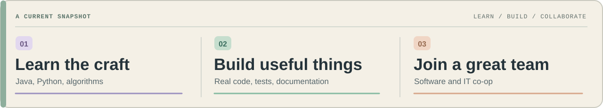
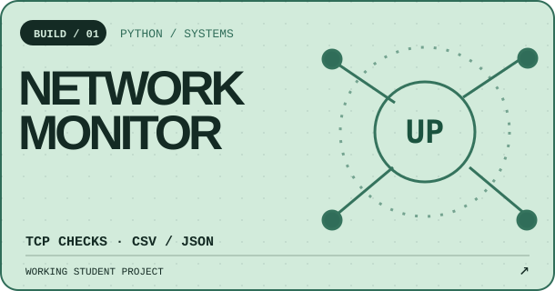
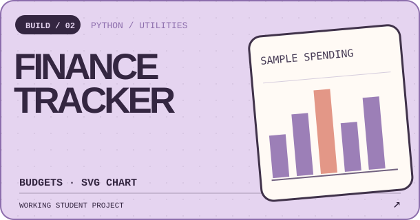
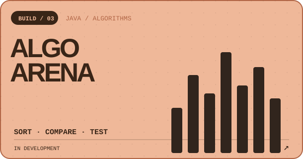
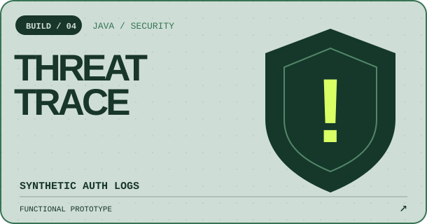
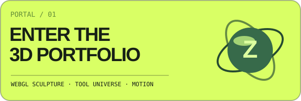
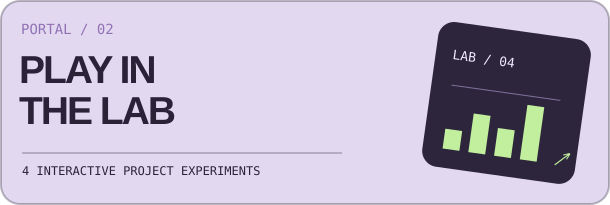
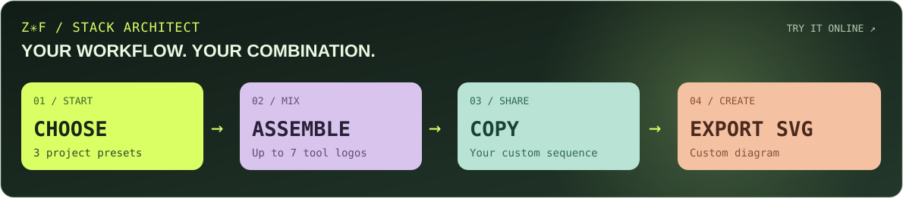
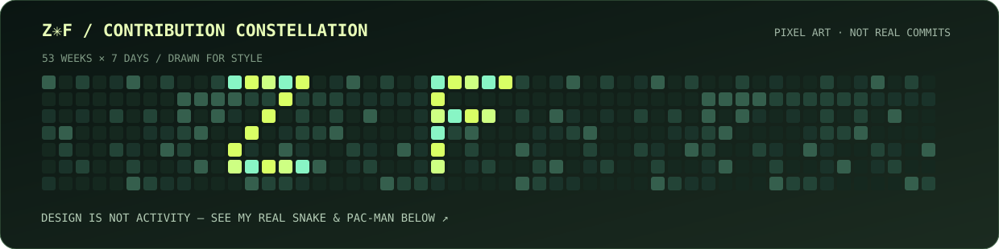

<div align="center">

<a href="https://zuhayer03.github.io/programming-journey/">

</a>

<br/>


<br/>

<a href="https://zuhayer03.github.io/programming-journey/"></a>
<a href="https://zuhayer03.github.io/programming-journey/lab.html"></a>
<a href="https://www.linkedin.com/in/zuhayer-alam-faiyaz-8bb1a3442/"></a>

<br/><br/>

**KETTERING UNIVERSITY** · COMPUTER SCIENCE · MICHIGAN, USA

<sub>Software engineering and IT co-op opportunities · Learning in public · Code you can inspect</sub>

</div>

---

<table>
<tr>
<td width="59%" valign="top">

### HI, I'M ZUHAYER ✳

I started out working with networks, support tickets, and the practical side of technology. That taught me something valuable: **understand the system before trying to fix it.**

Today I'm studying **Computer Science at Kettering University**, strengthening Java, Python, DSA, and software engineering foundations, and turning ideas into small, testable applications.

Interested in **software, infrastructure, AI automation, security tooling, and blockchain**. Focused on learning deeply rather than collecting buzzwords.

</td>
<td width="41%" valign="top">

### STATUS / DEVELOPER

```yaml
name: Zuhayer Alam Faiyaz
university: Kettering
focus: [Java, Python, DSA]
background: IT + Networks
current: Build + Learn
next: Software / IT Co-op
location: Michigan, USA
```

</td>
</tr>
</table>

### 01 / WHAT I'M WORKING TOWARD

<div align="center">

</div>

### 02 / SELECTED WORK — FOUR REAL BUILDS

<sub>Each illustration opens actual source code. Projects include tests and run instructions. These are educational applications, not production services.</sub>

<table>
<tr>
<td width="50%" valign="top">
<a href="https://github.com/zuhayer03/programming-journey/tree/main/projects/network-monitor"></a>
<p><strong><a href="https://github.com/zuhayer03/programming-journey/tree/main/projects/network-monitor">SOURCE / TESTS →</a></strong> TCP connectivity, connection time, and CSV/JSON reports.</p>
</td>
<td width="50%" valign="top">
<a href="https://github.com/zuhayer03/programming-journey/tree/main/projects/finance-tracker"></a>
<p><strong><a href="https://github.com/zuhayer03/programming-journey/tree/main/projects/finance-tracker">SOURCE / TESTS →</a></strong> Local expense summaries, budgeting, and SVG spending charts.</p>
</td>
</tr>
<tr>
<td width="50%" valign="top">
<a href="https://github.com/zuhayer03/programming-journey/tree/main/projects/algoarena"></a>
<p><strong><a href="https://github.com/zuhayer03/programming-journey/tree/main/projects/algoarena">SOURCE / TESTS →</a></strong> Java sorting comparisons and educational timing tests. In development.</p>
</td>
<td width="50%" valign="top">
<a href="https://github.com/zuhayer03/programming-journey/tree/main/projects/threattrace"></a>
<p><strong><a href="https://github.com/zuhayer03/programming-journey/tree/main/projects/threattrace">SOURCE / TESTS →</a></strong> Synthetic failed-login analysis and threshold alerts. Functional prototype.</p>
</td>
</tr>
</table>

<div align="center">

[](https://github.com/zuhayer03/zuhayer03/actions/workflows/profile-quality.yml)
[](https://github.com/zuhayer03/programming-journey/actions/workflows/portfolio-tests.yml)
[](https://github.com/zuhayer03/programming-journey/actions/workflows/site-quality.yml)
[](https://github.com/zuhayer03/programming-journey/actions/workflows/deploy-pages.yml)

</div>

### 03 / TWO PORTALS. A WHOLE LOT TO EXPLORE.

<table>
<tr>
<td width="50%" valign="top">
<a href="https://zuhayer03.github.io/programming-journey/"></a>
</td>
<td width="50%" valign="top">
<a href="https://zuhayer03.github.io/programming-journey/lab.html"></a>
</td>
</tr>
</table>

My <a href="https://zuhayer03.github.io/programming-journey/">portfolio site</a> features a real WebGL 3D sculpture, interactive tool explorer, project effects, and searchable navigation. In the <a href="https://zuhayer03.github.io/programming-journey/lab.html">lab</a>, experiment with sorting, simulated network checks, synthetic login events, and sample budgets. The browser demos are separate from the original Java/Python CLIs.

### 04 / THE TOOL UNIVERSE — PREMIUM DASHBOARD

<div align="center">

<a href="https://zuhayer03.github.io/programming-journey/#tools"></a>

**29 CLICKABLE LOGOS · 7 CATEGORIES · ONE CONNECTED WORKFLOW**

<sub>Tools I use, study, and experiment with at different levels, not claims of expert proficiency in all of them.</sub>

</div>

<table width="100%">
<tr>
<td width="50%" valign="top">
<p align="center"><strong>01 / PROGRAMMING & DEVELOPMENT</strong></p>
<table width="100%">
<tr>
<td width="25%" align="center" valign="middle"><a href="https://www.java.com"><picture><source media="(prefers-reduced-motion: reduce)" srcset="https://cdn.jsdelivr.net/gh/devicons/devicon@latest/icons/java/java-original.svg"/></picture><br/><sub><b>Java</b></sub></a></td>
<td width="25%" align="center" valign="middle"><a href="https://www.python.org"><picture><source media="(prefers-reduced-motion: reduce)" srcset="https://cdn.jsdelivr.net/gh/devicons/devicon@latest/icons/python/python-original.svg"/></picture><br/><sub><b>Python</b></sub></a></td>
<td width="25%" align="center" valign="middle"><a href="https://git-scm.com"><picture><source media="(prefers-reduced-motion: reduce)" srcset="https://cdn.jsdelivr.net/gh/devicons/devicon@latest/icons/git/git-original.svg"/></picture><br/><sub><b>Git</b></sub></a></td>
<td width="25%" align="center" valign="middle"><a href="https://github.com"><picture><source media="(prefers-reduced-motion: reduce)" srcset="https://cdn.jsdelivr.net/gh/devicons/devicon@latest/icons/github/github-original.svg"/></picture><br/><sub><b>GitHub</b></sub></a></td>
</tr>
<tr>
<td width="25%" align="center" valign="middle"><a href="https://code.visualstudio.com"><picture><source media="(prefers-reduced-motion: reduce)" srcset="https://cdn.jsdelivr.net/gh/devicons/devicon@latest/icons/vscode/vscode-original.svg"/></picture><br/><sub><b>VS Code</b></sub></a></td>
<td width="25%" align="center" valign="middle"><a href="https://www.jetbrains.com/idea/"><picture><source media="(prefers-reduced-motion: reduce)" srcset="https://cdn.jsdelivr.net/gh/devicons/devicon@latest/icons/intellij/intellij-original.svg"/></picture><br/><sub><b>IntelliJ IDEA</b></sub></a></td>
<td align="center"></td>
<td align="center"></td>
</tr>
</table>
<p align="center"><sub>FOUNDATIONS</sub></p>
<p align="center"><sub>Java · Python · Git · Source control</sub></p>
</td>
<td width="50%" valign="top">
<p align="center"><strong>02 / AI-ASSISTED CODING</strong></p>
<table width="100%">
<tr>
<td width="25%" align="center" valign="middle"><a href="https://cursor.com"><picture><source media="(prefers-reduced-motion: reduce)" srcset="assets/icons/cursor.svg"/></picture><br/><sub><b>Cursor</b></sub></a></td>
<td width="25%" align="center" valign="middle"><a href="https://github.com/features/copilot"><picture><source media="(prefers-reduced-motion: reduce)" srcset="assets/icons/githubcopilot.svg"/></picture><br/><sub><b>GitHub Copilot</b></sub></a></td>
<td width="25%" align="center" valign="middle"><a href="https://www.anthropic.com/claude-code"><picture><source media="(prefers-reduced-motion: reduce)" srcset="assets/icons/claude.svg"/></picture><br/><sub><b>Claude Code</b></sub></a></td>
<td width="25%" align="center" valign="middle"><a href="https://antigravity.google"><picture><source media="(prefers-reduced-motion: reduce)" srcset="https://www.google.com/s2/favicons?domain=antigravity.google&amp;sz=128"/></picture><br/><sub><b>Google Antigravity</b></sub></a></td>
</tr>
</table>
<p align="center"><sub>ASSISTED DEVELOPMENT</sub></p>
<p align="center"><sub>Faster iteration, solid foundations first</sub></p>
</td>
</tr>
<tr>
<td width="50%" valign="top">
<p align="center"><strong>03 / AGENTS & AUTOMATION</strong></p>
<table width="100%">
<tr>
<td width="25%" align="center" valign="middle"><a href="https://www.langchain.com/langgraph"><picture><source media="(prefers-reduced-motion: reduce)" srcset="assets/icons/langgraph.svg"/></picture><br/><sub><b>LangGraph</b></sub></a></td>
<td width="25%" align="center" valign="middle"><a href="https://google.github.io/adk-docs/"><picture><source media="(prefers-reduced-motion: reduce)" srcset="https://www.google.com/s2/favicons?domain=google.com&amp;sz=128"/></picture><br/><sub><b>Google ADK</b></sub></a></td>
<td width="25%" align="center" valign="middle"><a href="https://livekit.io"><picture><source media="(prefers-reduced-motion: reduce)" srcset="assets/icons/livekit.svg"/></picture><br/><sub><b>LiveKit Agents</b></sub></a></td>
<td width="25%" align="center" valign="middle"><a href="https://browser-use.com"><picture><source media="(prefers-reduced-motion: reduce)" srcset="https://www.google.com/s2/favicons?domain=browser-use.com&amp;sz=128"/></picture><br/><sub><b>Browser Use</b></sub></a></td>
</tr>
<tr>
<td width="25%" align="center" valign="middle"><a href="https://composio.dev"><picture><source media="(prefers-reduced-motion: reduce)" srcset="https://www.google.com/s2/favicons?domain=composio.dev&amp;sz=128"/></picture><br/><sub><b>Composio</b></sub></a></td>
<td width="25%" align="center" valign="middle"><a href="https://paperclip.ing"><picture><source media="(prefers-reduced-motion: reduce)" srcset="https://www.google.com/s2/favicons?domain=paperclip.ing&amp;sz=128"/></picture><br/><sub><b>Paperclip</b></sub></a></td>
<td align="center"></td>
<td align="center"></td>
</tr>
</table>
<p align="center"><sub>WORKFLOW ENGINEERING</sub></p>
<p align="center"><sub>Agents, orchestration & integration</sub></p>
</td>
<td width="50%" valign="top">
<p align="center"><strong>04 / MODELS & INFRASTRUCTURE</strong></p>
<table width="100%">
<tr>
<td width="25%" align="center" valign="middle"><a href="https://huggingface.co"><picture><source media="(prefers-reduced-motion: reduce)" srcset="assets/icons/huggingface.svg"/></picture><br/><sub><b>Hugging Face</b></sub></a></td>
<td width="25%" align="center" valign="middle"><a href="https://ollama.com"><picture><source media="(prefers-reduced-motion: reduce)" srcset="assets/icons/ollama.svg"/></picture><br/><sub><b>Ollama</b></sub></a></td>
<td width="25%" align="center" valign="middle"><a href="https://supabase.com"><picture><source media="(prefers-reduced-motion: reduce)" srcset="assets/icons/supabase.svg"/></picture><br/><sub><b>Supabase AI</b></sub></a></td>
<td width="25%" align="center" valign="middle"><a href="https://e2b.dev"><picture><source media="(prefers-reduced-motion: reduce)" srcset="https://www.google.com/s2/favicons?domain=e2b.dev&amp;sz=128"/></picture><br/><sub><b>E2B</b></sub></a></td>
</tr>
</table>
<p align="center"><sub>MODELS & SANDBOXES</sub></p>
<p align="center"><sub>Local models · cloud APIs · runtimes</sub></p>
</td>
</tr>
<tr>
<td width="50%" valign="top">
<p align="center"><strong>05 / CODE QUALITY & OBSERVABILITY</strong></p>
<table width="100%">
<tr>
<td width="25%" align="center" valign="middle"><a href="https://www.coderabbit.ai"><picture><source media="(prefers-reduced-motion: reduce)" srcset="https://www.google.com/s2/favicons?domain=coderabbit.ai&amp;sz=128"/></picture><br/><sub><b>CodeRabbit</b></sub></a></td>
<td width="25%" align="center" valign="middle"><a href="https://smith.langchain.com"><picture><source media="(prefers-reduced-motion: reduce)" srcset="https://www.google.com/s2/favicons?domain=smith.langchain.com&amp;sz=128"/></picture><br/><sub><b>LangSmith</b></sub></a></td>
<td width="25%" align="center" valign="middle"><a href="https://sentry.io"><picture><source media="(prefers-reduced-motion: reduce)" srcset="assets/icons/sentry.svg"/></picture><br/><sub><b>Sentry Seer</b></sub></a></td>
<td align="center"></td>
</tr>
</table>
<p align="center"><strong>07 / CODING PRACTICE</strong></p>
<table width="100%">
<tr>
<td width="25%" align="center" valign="middle"><a href="https://leetcode.com"><picture><source media="(prefers-reduced-motion: reduce)" srcset="assets/icons/leetcode.svg"/></picture><br/><sub><b>LeetCode</b></sub></a></td>
<td width="25%" align="center" valign="middle"><a href="https://neetcode.io"><picture><source media="(prefers-reduced-motion: reduce)" srcset="https://www.google.com/s2/favicons?domain=neetcode.io&amp;sz=128"/></picture><br/><sub><b>NeetCode</b></sub></a></td>
<td align="center"></td>
<td align="center"></td>
</tr>
</table>
<p align="center"><sub>LEARN / TEST / REFINE</sub></p>
<p align="center"><sub>Review · trace · solve · repeat</sub></p>
</td>
<td width="50%" valign="top">
<p align="center"><strong>06 / DESIGN, RESEARCH & ORGANIZATION</strong></p>
<table width="100%">
<tr>
<td width="25%" align="center" valign="middle"><a href="https://www.figma.com"><picture><source media="(prefers-reduced-motion: reduce)" srcset="assets/icons/figma.svg"/></picture><br/><sub><b>Figma</b></sub></a></td>
<td width="25%" align="center" valign="middle"><a href="https://www.notion.so"><picture><source media="(prefers-reduced-motion: reduce)" srcset="assets/icons/notion.svg"/></picture><br/><sub><b>Notion</b></sub></a></td>
<td width="25%" align="center" valign="middle"><a href="https://notebooklm.google.com"><picture><source media="(prefers-reduced-motion: reduce)" srcset="https://www.google.com/s2/favicons?domain=notebooklm.google.com&amp;sz=128"/></picture><br/><sub><b>NotebookLM</b></sub></a></td>
<td width="25%" align="center" valign="middle"><a href="https://www.perplexity.ai"><picture><source media="(prefers-reduced-motion: reduce)" srcset="assets/icons/perplexity.svg"/></picture><br/><sub><b>Perplexity</b></sub></a></td>
</tr>
</table>
<p align="center"><sub>DESIGN & RESEARCH</sub></p>
<p align="center"><sub>Creative prototyping · notes · productivity</sub></p>
</td>
</tr>
<tr>
<td width="50%" valign="top">
<p align="center"><strong>08 / STACK ARCHITECT</strong></p><p align="center"><a href="https://zuhayer03.github.io/programming-journey/#stack-lab"></a></p><p align="center"><sub>Mix up to seven tools · Export an SVG</sub></p><p align="center"><a href="https://zuhayer03.github.io/programming-journey/#stack-lab"><b>BUILD YOUR STACK ↗</b></a></p>
</td>
<td width="50%" valign="top">
<p align="center"><strong>09 / DEVELOPMENT PIPELINE</strong></p><p align="center"></p><p align="center"><sub>IDEA → CODE → TEST → SHIP</sub></p><p align="center"><a href="https://zuhayer03.github.io/programming-journey/#tools"><b>EXPLORE ALL TOOLS ↗</b></a></p>
</td>
</tr>
</table>

<div align="center">

<a href="https://zuhayer03.github.io/programming-journey/#tools"></a>

**[EXPLORE THE INTERACTIVE TOOL UNIVERSE ↗](https://zuhayer03.github.io/programming-journey/#tools)**

<sub>Brand logos identify their respective products. This dashboard uses original visual composition.</sub>

</div>

### 04.8 / THE CONTRIBUTION CONSTELLATION — DESIGN, NOT FAKE COMMITS

<div align="center">

<a href="https://zuhayer03.github.io/programming-journey/constellation.html">

</a>

**[✳ OPEN THE INTERACTIVE PIXEL-ART STUDIO — DRAW YOUR OWN GRAPH ↗](https://zuhayer03.github.io/programming-journey/constellation.html)**

<sub>Inspired by contribution graph art. The linked editor creates exportable SVG artwork; it never fabricates or backdates commits. Actual contribution data appears in the animated graphs below.</sub>

</div>

### 05 / MY ANIMATED CONTRIBUTION ARCADE 🕹️

**LEVEL 01 — THE CONTRIBUTION SNAKE**


<div align="center">

<picture>
<source media="(prefers-color-scheme: dark)" srcset="https://raw.githubusercontent.com/zuhayer03/zuhayer03/output/snake-dark.svg"/>
<source media="(prefers-color-scheme: light)" srcset="https://raw.githubusercontent.com/zuhayer03/zuhayer03/output/snake.svg"/>

</picture>

<sub>Generated from my public contribution graph by a scheduled GitHub Action.</sub>

</div>

<div align="center">

**LEVEL 02 — PAC-MAN VS. MY GITHUB CONTRIBUTIONS 👻**

<picture>
  <source media="(prefers-color-scheme: dark)" srcset="https://raw.githubusercontent.com/zuhayer03/zuhayer03/output/pacman-contribution-graph-dark.svg"/>
  <source media="(prefers-color-scheme: light)" srcset="https://raw.githubusercontent.com/zuhayer03/zuhayer03/output/pacman-contribution-graph.svg"/>
  
</picture>

<sub>Automatically updated daily from my actual contributions. The GitHub graphic is an animation, not an embedded playable game.</sub>

<br/>

<a href="https://zuhayer03.github.io/programming-journey/arcade.html"></a>

**[PLAY THE REAL KEYBOARD & TOUCH-CONTROLLED MINI GAME ↗](https://zuhayer03.github.io/programming-journey/arcade.html)**

<br/>

**BONUS VISUAL — ORIGINAL CODING GIF**


</div>

<details>
<summary><strong>＋ OPEN GITHUB STATS</strong></summary>
<br/>
<div align="center">


</div>
<sub>Statistics depend on third-party availability and do not measure programming proficiency.</sub>
</details>

<div align="center">

### BUILD WITH PURPOSE. KEEP GETTING BETTER.

If you're building useful software or recruiting for a software engineering / IT co-op, I'd love to connect.

<a href="https://www.linkedin.com/in/zuhayer-alam-faiyaz-8bb1a3442/"></a>
<a href="https://github.com/zuhayer03/programming-journey"></a>

<br/><br/>


<sub>Z✳F / CREATIVE ENGINEERING · © Zuhayer Alam Faiyaz</sub>

</div>