<div align="center">

<a href="https://zuhayer03.github.io/programming-journey/">
<picture><source media="(prefers-reduced-motion: reduce)" srcset="assets/identity.svg"/>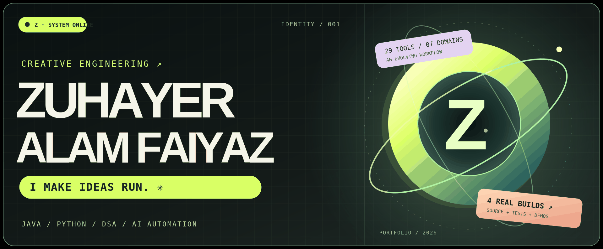</picture>
</a>

<br/>


<br/>

<p align="center">

**[Portfolio](https://zuhayer03.github.io/programming-journey/)** &nbsp; · &nbsp; **[My Projects](#projects)** &nbsp; · &nbsp; **[Tool Studio](#toolkit)** &nbsp; · &nbsp; **[Arcade](#arcade)** &nbsp; · &nbsp; **[Connect](https://www.linkedin.com/in/zuhayer-alam-faiyaz-8bb1a3442/)**

</p>

<br/><br/>

**KETTERING UNIVERSITY** · COMPUTER SCIENCE · MICHIGAN, USA

<sub>Software engineering and IT co-op opportunities · Learning in public · Code you can inspect</sub>

</div>

---

<table>
<tr>
<td width="59%" valign="top">

### HI, I'M ZUHAYER ✳

I started out working with networks, support tickets, and the practical side of technology. That taught me something valuable: **understand the system before trying to fix it.**

Today I'm studying **Computer Science at Kettering University**, strengthening Java, Python, DSA, and software engineering foundations, and turning ideas into small, testable applications.

Interested in **software, infrastructure, AI automation, security tooling, and blockchain**. Focused on learning deeply rather than collecting buzzwords.

</td>
<td width="41%" valign="top">

### STATUS / DEVELOPER

```yaml
name: Zuhayer Alam Faiyaz
university: Kettering
focus: [Java, Python, DSA]
background: IT + Networks
current: Build + Learn
next: Software / IT Co-op
location: Michigan, USA
```

</td>
</tr>
</table>

<a id="now"></a>

### 01 / WHAT I'M WORKING TOWARD

<div align="center">
<picture><source media="(prefers-reduced-motion: reduce)" srcset="assets/current-mission.svg"/>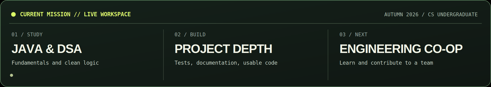</picture>
</div>

<a id="projects"></a>

### 02 / SELECTED WORK — FOUR REAL BUILDS

<sub>Each illustration opens actual source code. Projects include tests and run instructions. These are educational applications, not production services.</sub>

<table>
<tr>
<td width="50%" valign="top">
<a href="https://github.com/zuhayer03/programming-journey/tree/main/projects/network-monitor"><picture><source media="(prefers-reduced-motion: reduce)" srcset="assets/feature-network-monitor.svg"/>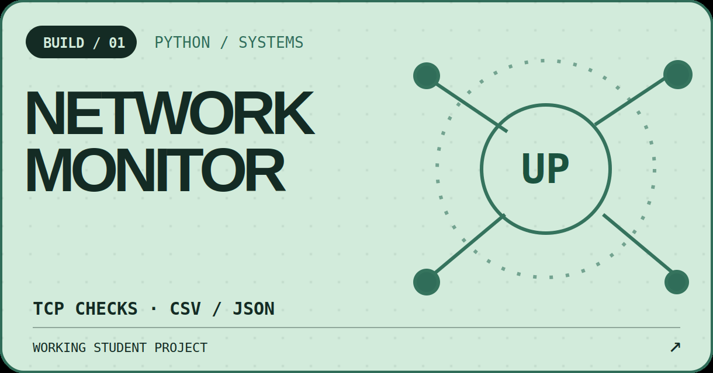</picture></a>
<p><strong><a href="https://github.com/zuhayer03/programming-journey/tree/main/projects/network-monitor">SOURCE / TESTS →</a></strong> TCP connectivity, connection time, and CSV/JSON reports.</p>
</td>
<td width="50%" valign="top">
<a href="https://github.com/zuhayer03/programming-journey/tree/main/projects/finance-tracker"><picture><source media="(prefers-reduced-motion: reduce)" srcset="assets/feature-finance-tracker.svg"/>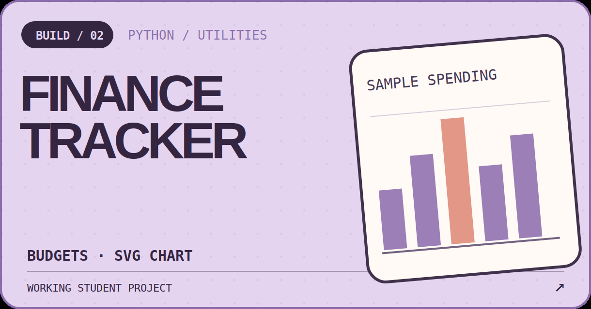</picture></a>
<p><strong><a href="https://github.com/zuhayer03/programming-journey/tree/main/projects/finance-tracker">SOURCE / TESTS →</a></strong> Local expense summaries, budgeting, and SVG spending charts.</p>
</td>
</tr>
<tr>
<td width="50%" valign="top">
<a href="https://github.com/zuhayer03/programming-journey/tree/main/projects/algoarena"><picture><source media="(prefers-reduced-motion: reduce)" srcset="assets/feature-algoarena.svg"/>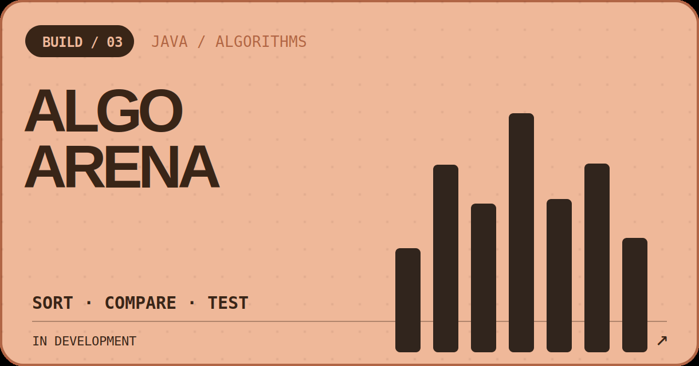</picture></a>
<p><strong><a href="https://github.com/zuhayer03/programming-journey/tree/main/projects/algoarena">SOURCE / TESTS →</a></strong> Java sorting comparisons and educational timing tests. In development.</p>
</td>
<td width="50%" valign="top">
<a href="https://github.com/zuhayer03/programming-journey/tree/main/projects/threattrace"><picture><source media="(prefers-reduced-motion: reduce)" srcset="assets/feature-threattrace.svg"/>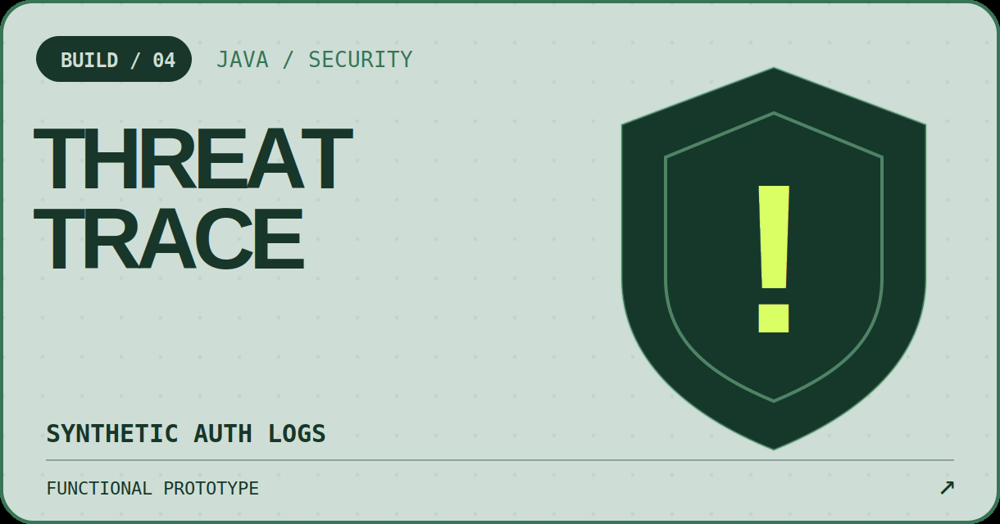</picture></a>
<p><strong><a href="https://github.com/zuhayer03/programming-journey/tree/main/projects/threattrace">SOURCE / TESTS →</a></strong> Synthetic failed-login analysis and threshold alerts. Functional prototype.</p>
</td>
</tr>
</table>

<details>
<summary><strong>▶ See all four projects in motion — animated showcase</strong></summary>

<div align="center">

<a href="https://github.com/zuhayer03/programming-journey/blob/main/MOTION_GALLERY.md"><picture><source media="(prefers-reduced-motion: reduce)" srcset="https://raw.githubusercontent.com/zuhayer03/zuhayer03/output/demos/project-reel.png"/>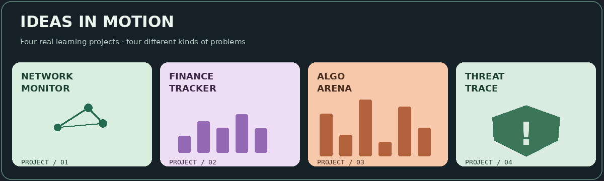</picture></a>

**[Explore the complete GIF gallery &amp; project walkthroughs →](https://github.com/zuhayer03/programming-journey/blob/main/MOTION_GALLERY.md)**

<sub>Illustrations of student-project concepts, not recordings of live software.</sub>

</div>

</details>

<div align="center">

[](https://github.com/zuhayer03/zuhayer03/actions/workflows/profile-quality.yml)
[](https://github.com/zuhayer03/programming-journey/actions/workflows/portfolio-tests.yml)
[](https://github.com/zuhayer03/programming-journey/actions/workflows/site-quality.yml)
[](https://github.com/zuhayer03/programming-journey/actions/workflows/deploy-pages.yml)

</div>

<a id="explore"></a>

### 03 / EXPLORE THE PORTFOLIO & LAB

<table>
<tr>
<td width="50%" valign="top">
<a href="https://zuhayer03.github.io/programming-journey/"><picture><source media="(prefers-reduced-motion: reduce)" srcset="assets/portal-portfolio.svg"/>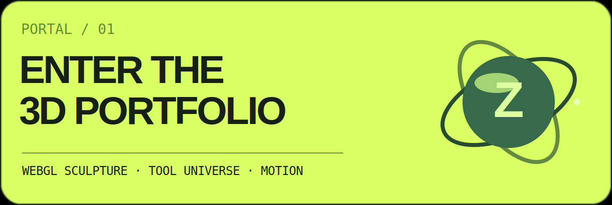</picture></a>
</td>
<td width="50%" valign="top">
<a href="https://zuhayer03.github.io/programming-journey/lab.html"><picture><source media="(prefers-reduced-motion: reduce)" srcset="assets/portal-lab.svg"/>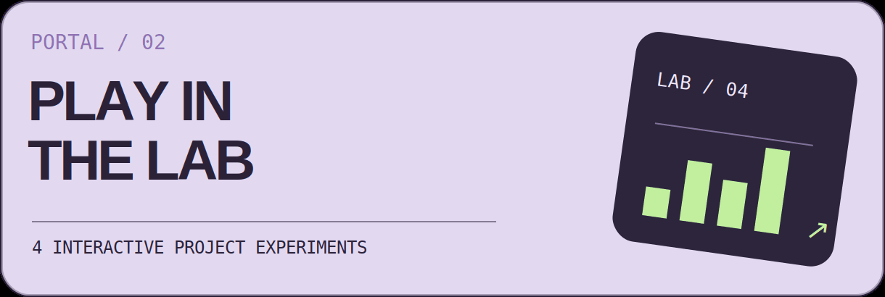</picture></a>
</td>
</tr>
</table>

My <a href="https://zuhayer03.github.io/programming-journey/">portfolio site</a> features a real WebGL 3D sculpture, interactive tool explorer, project effects, and searchable navigation. In the <a href="https://zuhayer03.github.io/programming-journey/lab.html">lab</a>, experiment with sorting, simulated network checks, synthetic login events, and sample budgets. The browser demos are separate from the original Java/Python CLIs.

<a id="toolkit"></a>

### 04 / MY TOOLKIT — THE ANIMATED ICON WALL ✳

<div align="center">

<a href="https://zuhayer03.github.io/programming-journey/dashboard.html"><picture><source media="(prefers-reduced-motion: reduce)" srcset="assets/tool-universe.svg"/>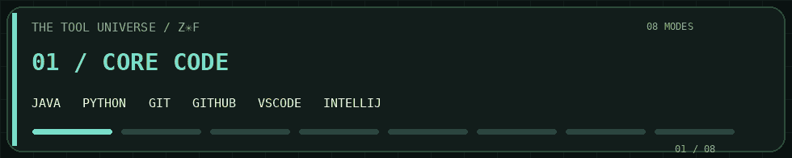</picture></a>

**29 TOOLS · ONE COLORFUL MOTION WALL · NO CATEGORIES**

<sub>Java · Python · Git · AI coding · Agents · Infrastructure · Design · Practice</sub>

**[EXPLORE THE INTERACTIVE 3D DASHBOARD ↗](https://zuhayer03.github.io/programming-journey/dashboard.html)** · **[BUILD A CUSTOM STACK ↗](https://zuhayer03.github.io/programming-journey/#stack-lab)**

</div>

<div align="center">

<a href="https://www.java.com" title="Java"></a>
<a href="https://www.python.org" title="Python">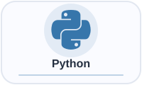</a>
<a href="https://git-scm.com" title="Git">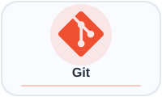</a>
<a href="https://github.com" title="GitHub"></a>
<a href="https://code.visualstudio.com" title="VS Code"></a>
<a href="https://www.jetbrains.com/idea/" title="IntelliJ IDEA"></a>
<a href="https://cursor.com" title="Cursor"></a>
<a href="https://github.com/features/copilot" title="GitHub Copilot"></a>
<a href="https://www.anthropic.com/claude-code" title="Claude Code">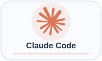</a>
<a href="https://antigravity.google" title="Google Antigravity"></a>
<a href="https://www.langchain.com/langgraph" title="LangGraph">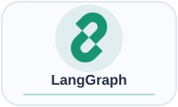</a>
<a href="https://google.github.io/adk-docs/" title="Google ADK"></a>
<a href="https://livekit.io" title="LiveKit Agents">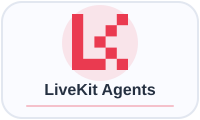</a>
<a href="https://browser-use.com" title="Browser Use"></a>
<a href="https://composio.dev" title="Composio">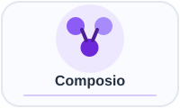</a>
<a href="https://paperclip.ing" title="Paperclip">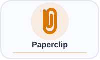</a>
<a href="https://huggingface.co" title="Hugging Face"></a>
<a href="https://ollama.com" title="Ollama">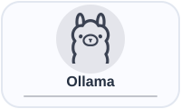</a>
<a href="https://supabase.com" title="Supabase AI"></a>
<a href="https://e2b.dev" title="E2B">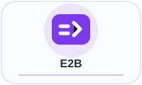</a>
<a href="https://www.coderabbit.ai" title="CodeRabbit">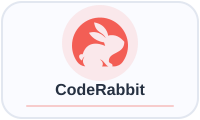</a>
<a href="https://smith.langchain.com" title="LangSmith"></a>
<a href="https://sentry.io" title="Sentry Seer">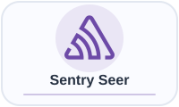</a>
<a href="https://www.figma.com" title="Figma">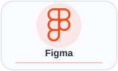</a>
<a href="https://www.notion.so" title="Notion">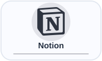</a>
<a href="https://notebooklm.google.com" title="NotebookLM"></a>
<a href="https://www.perplexity.ai" title="Perplexity">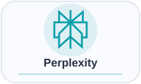</a>
<a href="https://leetcode.com" title="LeetCode"></a>
<a href="https://neetcode.io" title="NeetCode"></a>

<br/>

<sub>29 tools · colorful floating icons · tap any card to explore its tool</sub>

<sub>Original brand artwork where available; custom labeled symbols for tools without a verified icon.</sub>

</div>

<details>
<summary><strong>＋ Expand the 9 original animated tool cards (full visual collection)</strong></summary>

<sub>All original logos and moving cards are preserved below. The gallery is collapsed by default to keep the profile easy to scan.</sub>

<table width="100%">
<tr>
<td width="50%" valign="top">
<a href="https://zuhayer03.github.io/programming-journey/dashboard.html#core"><picture><source media="(prefers-reduced-motion: reduce)" srcset="https://raw.githubusercontent.com/zuhayer03/zuhayer03/output/dashboard/core.png"/>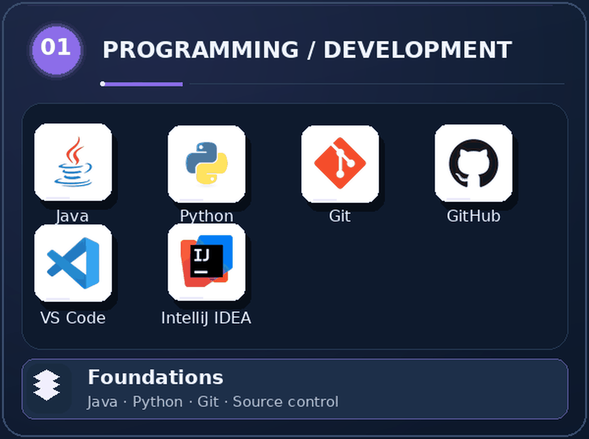</picture></a>
</td>
<td width="50%" valign="top">
<a href="https://zuhayer03.github.io/programming-journey/dashboard.html#coding"><picture><source media="(prefers-reduced-motion: reduce)" srcset="https://raw.githubusercontent.com/zuhayer03/zuhayer03/output/dashboard/coding.png"/>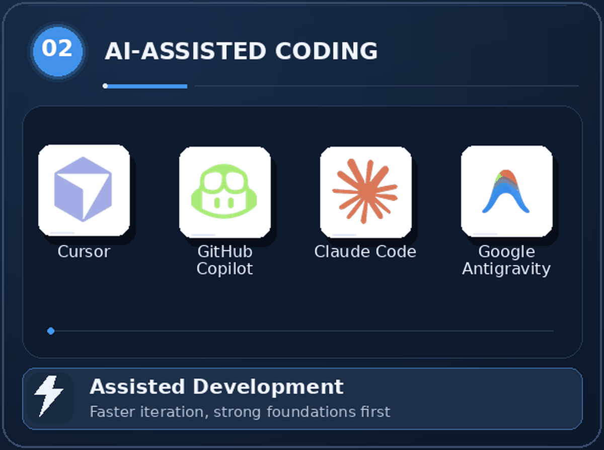</picture></a>
</td>
</tr>
<tr>
<td width="50%" valign="top">
<a href="https://zuhayer03.github.io/programming-journey/dashboard.html#agents"><picture><source media="(prefers-reduced-motion: reduce)" srcset="https://raw.githubusercontent.com/zuhayer03/zuhayer03/output/dashboard/agents.png"/>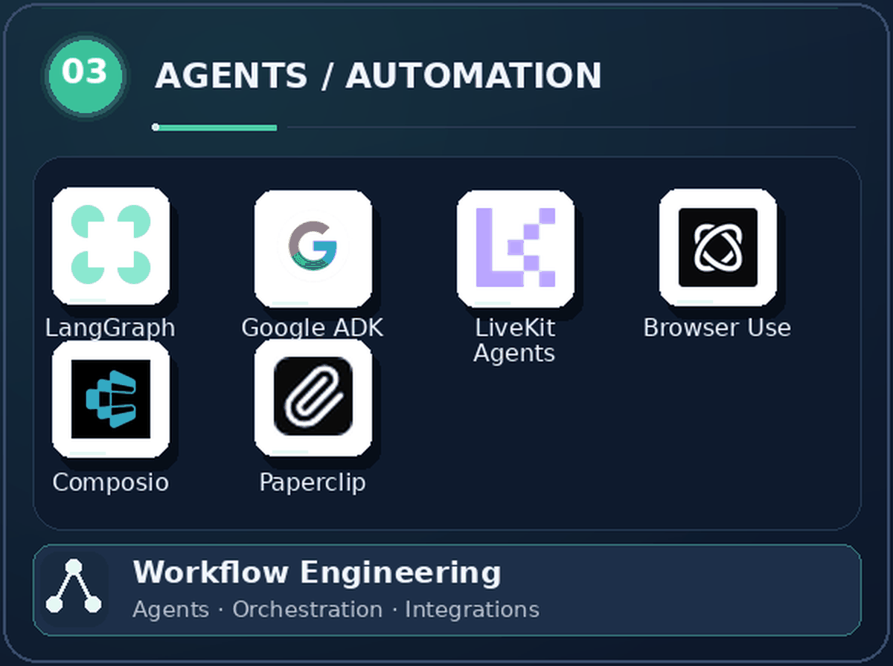</picture></a>
</td>
<td width="50%" valign="top">
<a href="https://zuhayer03.github.io/programming-journey/dashboard.html#infra"><picture><source media="(prefers-reduced-motion: reduce)" srcset="https://raw.githubusercontent.com/zuhayer03/zuhayer03/output/dashboard/infra.png"/>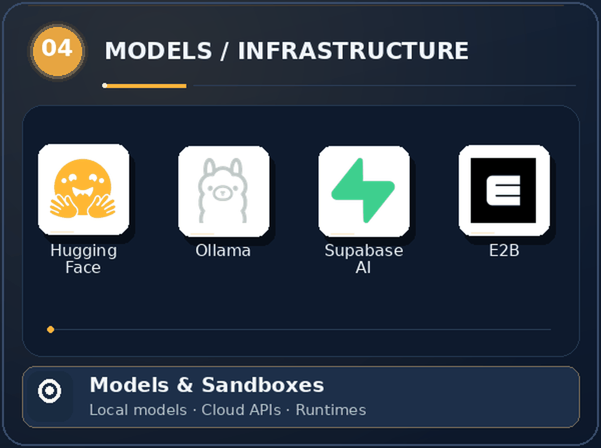</picture></a>
</td>
</tr>
<tr>
<td width="50%" valign="top">
<a href="https://zuhayer03.github.io/programming-journey/dashboard.html#quality"><picture><source media="(prefers-reduced-motion: reduce)" srcset="https://raw.githubusercontent.com/zuhayer03/zuhayer03/output/dashboard/quality.png"/>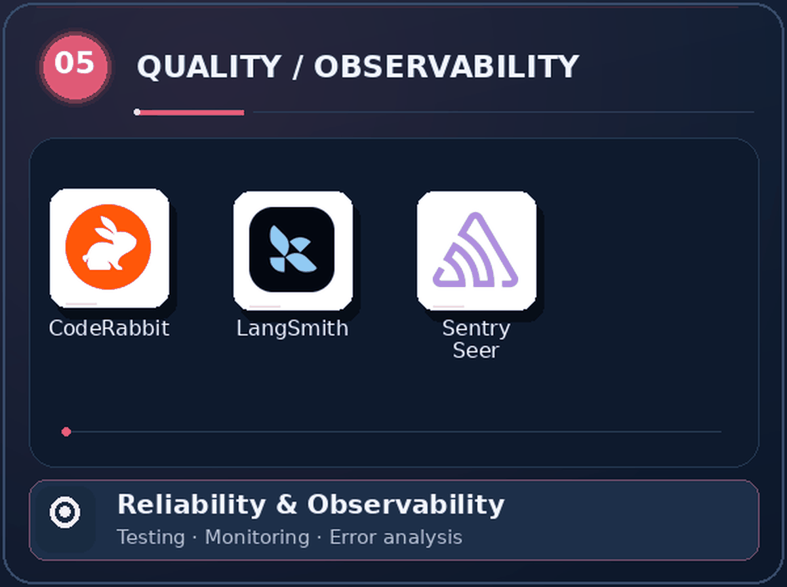</picture></a>
</td>
<td width="50%" valign="top">
<a href="https://zuhayer03.github.io/programming-journey/dashboard.html#design"><picture><source media="(prefers-reduced-motion: reduce)" srcset="https://raw.githubusercontent.com/zuhayer03/zuhayer03/output/dashboard/design.png"/>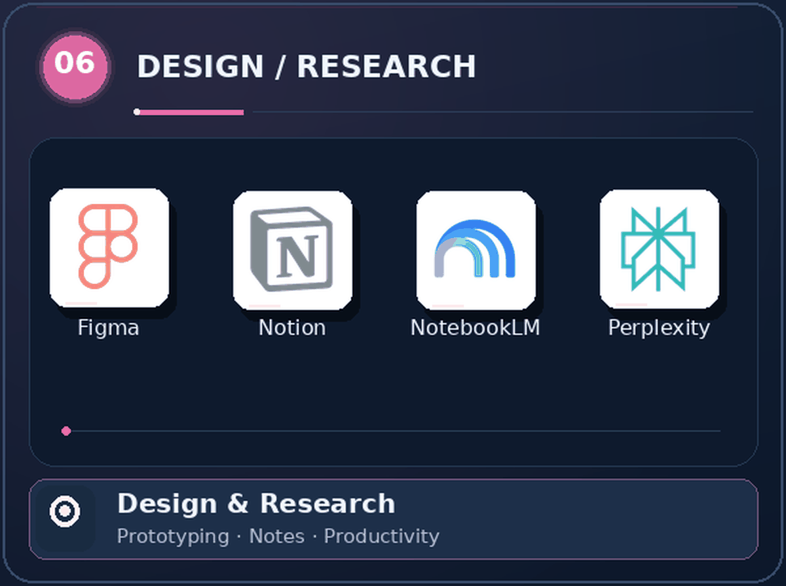</picture></a>
</td>
</tr>
<tr>
<td width="50%" valign="top">
<a href="https://zuhayer03.github.io/programming-journey/dashboard.html#practice"><picture><source media="(prefers-reduced-motion: reduce)" srcset="https://raw.githubusercontent.com/zuhayer03/zuhayer03/output/dashboard/practice.png"/>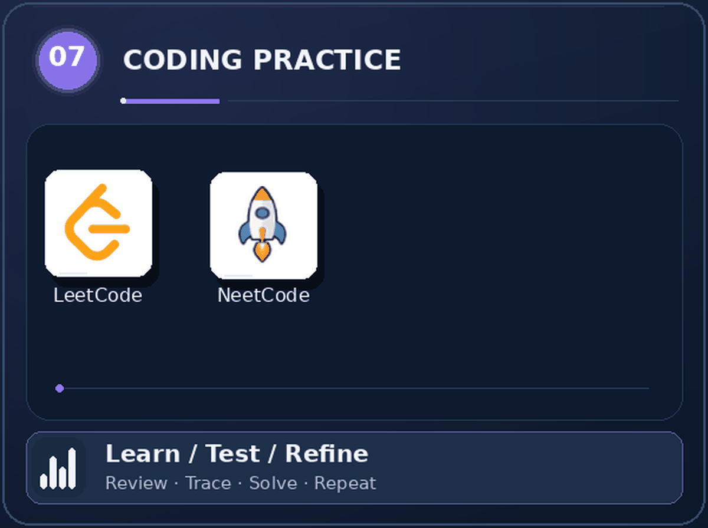</picture></a>
</td>
<td width="50%" valign="top">
<a href="https://zuhayer03.github.io/programming-journey/dashboard.html#stack"><picture><source media="(prefers-reduced-motion: reduce)" srcset="https://raw.githubusercontent.com/zuhayer03/zuhayer03/output/dashboard/stack.png"/>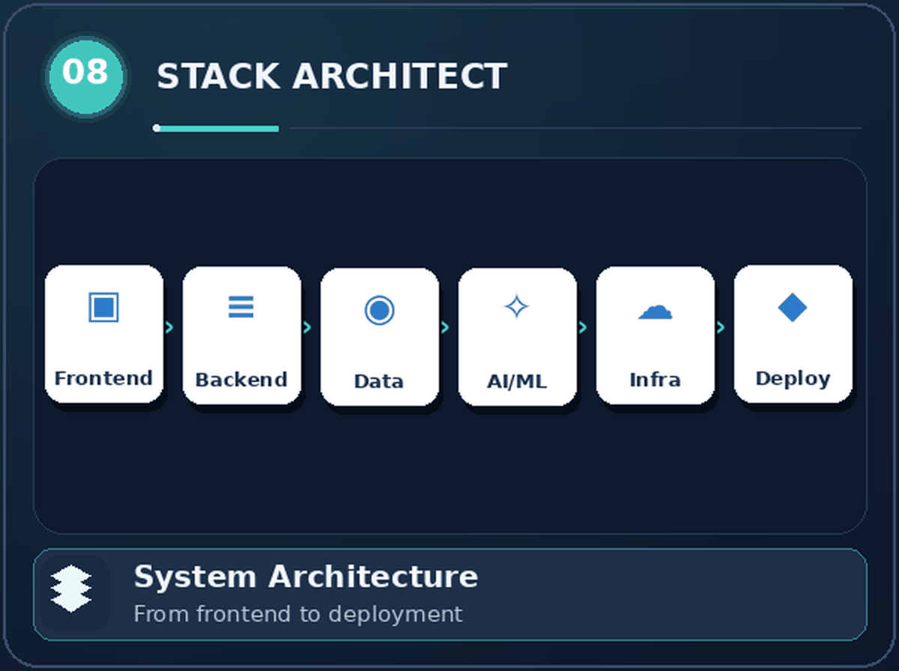</picture></a>
</td>
</tr>
<tr><td colspan="2" width="100%" valign="top">
<a href="https://zuhayer03.github.io/programming-journey/dashboard.html#pipeline"><picture><source media="(prefers-reduced-motion: reduce)" srcset="https://raw.githubusercontent.com/zuhayer03/zuhayer03/output/dashboard/pipeline.png"/>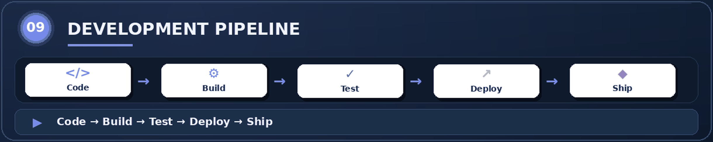</picture></a>
</td></tr>
</table>

</details>


<details>
<summary><strong>＋ BONUS / CONTRIBUTION ART STUDIO</strong></summary>


<div align="center">

<a href="https://zuhayer03.github.io/programming-journey/constellation.html">
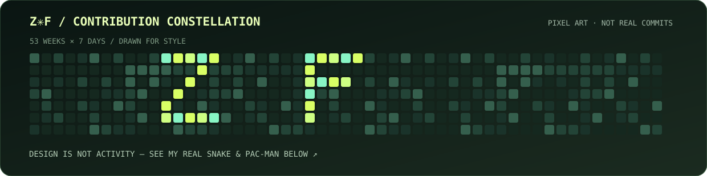
</a>

**[✳ OPEN THE INTERACTIVE PIXEL-ART STUDIO — DRAW YOUR OWN GRAPH ↗](https://zuhayer03.github.io/programming-journey/constellation.html)**

<sub>Inspired by contribution graph art. The linked editor creates exportable SVG artwork; it never fabricates or backdates commits. Actual contribution data appears in the animated graphs below.</sub>

</div>

</details>

<a id="coding-desk"></a>

### 04.7 / THE CODING DESK — MOTION + LOFI 🎧

<div align="center">

<sub>A tiny corner for building, testing, and keeping the creative energy going.</sub>

</div>

<table>
<tr>
<td width="50%" valign="top">

<a href="https://zuhayer03.github.io/programming-journey/dashboard.html"></a>

**TOOLS IN MOTION**  
<sub>Explore my [interactive developer toolbox](https://zuhayer03.github.io/programming-journey/dashboard.html).</sub>

</td>
<td width="50%" valign="top">

<a href="https://github.com/zuhayer03/programming-journey">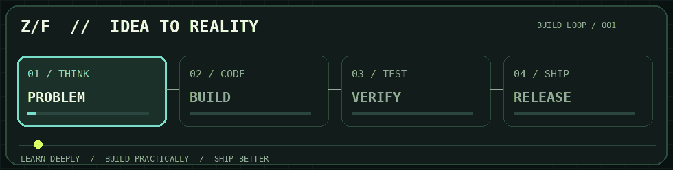</a>

**FROM CODE TO SHIP**  
<sub>Small builds, testing, and improving things a little at a time.</sub>

</td>
</tr>
</table>

<div align="center">

**NOW PLAYING / LOFI BEATS FOR FOCUS**

<a href="https://open.spotify.com/playlist/37i9dQZF1DWWQRwui0ExPn" title="Click to open Spotify's lofi beats playlist"><picture><source media="(prefers-reduced-motion: reduce)" srcset="https://raw.githubusercontent.com/zuhayer03/zuhayer03/output/spotify-lofi-player.png"/>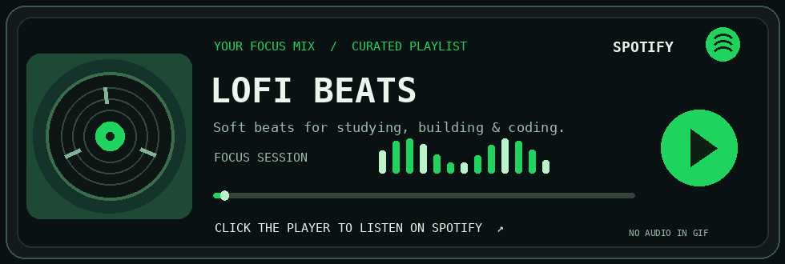</picture></a>

<sub>🎧 Click the animated player to open <a href="https://open.spotify.com/playlist/37i9dQZF1DWWQRwui0ExPn">Spotify's lofi beats playlist</a>. GIF preview only—audio plays on Spotify, not in this README.</sub>

</div>

<details>
<summary><strong>＋ ENTER THE TOOL COSMOS / BONUS ANIMATED GIF</strong></summary>

<div align="center">

<a href="https://zuhayer03.github.io/programming-journey/dashboard.html">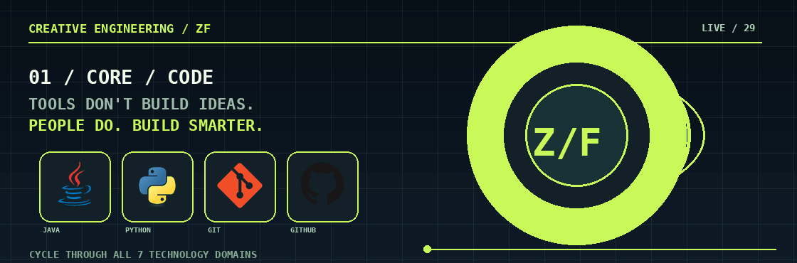</a>

**[EXPLORE THE INTERACTIVE TOOL UNIVERSE ↗](https://zuhayer03.github.io/programming-journey/dashboard.html)**

</div>

</details>

<a id="arcade"></a>

### 05 / THE CONTRIBUTION ARCADE 🕹️

**LEVEL 01 — THE CONTRIBUTION SNAKE**

<div align="center">

<picture>
<source media="(prefers-color-scheme: dark)" srcset="https://raw.githubusercontent.com/zuhayer03/zuhayer03/output/snake-dark.svg"/>
<source media="(prefers-color-scheme: light)" srcset="https://raw.githubusercontent.com/zuhayer03/zuhayer03/output/snake.svg"/>

</picture>

<sub>Generated from my public contribution graph by a scheduled GitHub Action.</sub>

</div>

<div align="center">

**LEVEL 02 — PAC-MAN VS. MY GITHUB CONTRIBUTIONS 👻**

<picture>
  <source media="(prefers-color-scheme: dark)" srcset="https://raw.githubusercontent.com/zuhayer03/zuhayer03/output/pacman-contribution-graph-dark.svg"/>
  <source media="(prefers-color-scheme: light)" srcset="https://raw.githubusercontent.com/zuhayer03/zuhayer03/output/pacman-contribution-graph.svg"/>
  
</picture>

<sub>Automatically updated daily from my actual contributions. The GitHub graphic is an animation, not an embedded playable game.</sub>

<br/>

<a href="https://zuhayer03.github.io/programming-journey/arcade.html"></a>

**[PLAY THE REAL KEYBOARD & TOUCH-CONTROLLED MINI GAME ↗](https://zuhayer03.github.io/programming-journey/arcade.html)**

<br/>

**BONUS / ANIMATED CODING CONSOLE**

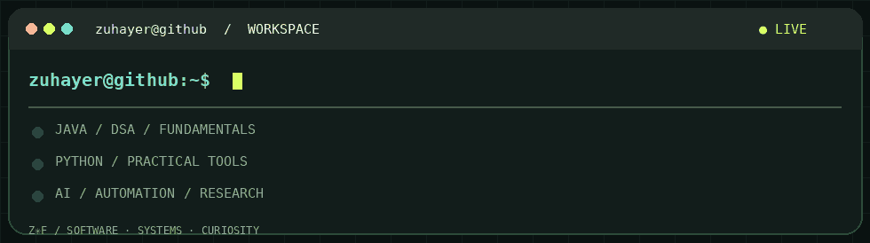

</div>

<details>
<summary><strong>＋ OPEN GITHUB STATS</strong></summary>
<br/>
<div align="center">


</div>
<sub>Statistics depend on third-party availability and do not measure programming proficiency.</sub>
</details>

<div align="center">

### BUILD WITH PURPOSE. KEEP GETTING BETTER.

If you're building useful software or recruiting for a software engineering / IT co-op, I'd love to connect.

<a href="https://www.linkedin.com/in/zuhayer-alam-faiyaz-8bb1a3442/"></a>
<a href="https://github.com/zuhayer03/programming-journey"></a>

<br/><br/>

<picture><source media="(prefers-reduced-motion: reduce)" srcset="assets/signoff.svg"/>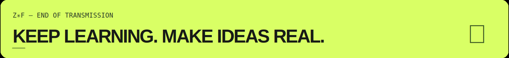</picture>

<sub>Z✳F / CREATIVE ENGINEERING · © Zuhayer Alam Faiyaz</sub>

</div>