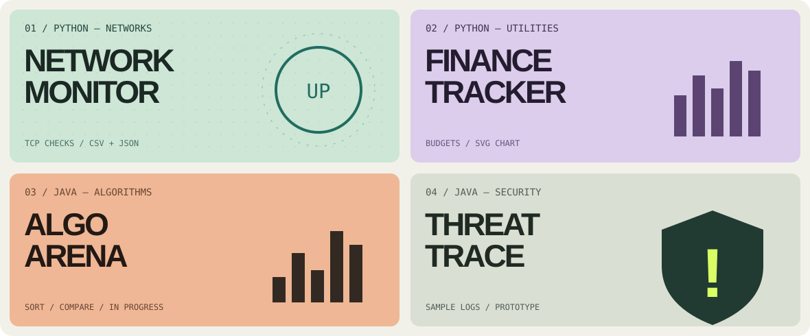

<div align="center">


<br/>

<a href="https://zuhayer03.github.io/programming-journey/"></a>
<a href="https://www.linkedin.com/in/zuhayer-alam-faiyaz-8bb1a3442/"></a>
<a href="https://github.com/zuhayer03/programming-journey/tree/main/projects"></a>

<br/><br/>


<sub>CS @ Kettering University &nbsp; / &nbsp; Michigan, USA &nbsp; / &nbsp; Open to software engineering &amp; IT co-op roles</sub>

</div>

---

### `01` · WHO IS BEHIND THE TERMINAL?

```yaml
name: Zuhayer Alam Faiyaz
role: Computer Science undergraduate
university: Kettering University
location: Michigan, USA
background: IT support and network infrastructure
main_focus: [Java, Python, Data Structures, Algorithms]
curious_about: [AI Automation, Security Tooling, Blockchain]
next_mission: Software Engineering / IT Co-op
```

Before leaning into software engineering, I worked on **IT support and network operations**. That experience made me curious about the systems behind the screen: how they work, how they break, and how code can make them better.

These days I'm building on that foundation through **Java, Python, object-oriented programming, algorithms, and small, testable applications**. My long-term interests span intelligent developer tools, resilient systems, and automation.

> Less buzzword bingo. More things you can actually run.

### `02` · CURRENT TOOLKIT

<div align="center">


<br/>


</div>

### `03` · FOUR BUILDS / ONE MISSION

*The code is real. The descriptions are deliberately honest about scope and maturity.*

<div align="center">

</div>

| Project | Source & tests | Current scope |
|:--|:--|:--|
| **01 · Network Monitor** | [Explore Python source →](https://github.com/zuhayer03/programming-journey/tree/main/projects/network-monitor) | TCP host/port checks, latency, CSV/JSON reports |
| **02 · Finance Tracker** | [Explore Python source →](https://github.com/zuhayer03/programming-journey/tree/main/projects/finance-tracker) | Sample expense analysis, budgeting, standalone SVG chart |
| **03 · AlgoArena** | [Explore Java source →](https://github.com/zuhayer03/programming-journey/tree/main/projects/algoarena) | Console sorting comparisons; **in development** |
| **04 · ThreatTrace** | [Explore Java source →](https://github.com/zuhayer03/programming-journey/tree/main/projects/threattrace) | Synthetic login-event analysis; **completed prototype** |

The code lives in the [**Programming Journey project directory**](https://github.com/zuhayer03/programming-journey/tree/main/projects). Each folder includes a README and tests. These are student programs, **not production services**.

<details>
<summary><b>＋ SIDE QUESTS / MORE CODE</b></summary>
<br/>

- 🤖 [**ToolPilot**](https://github.com/zuhayer03/programming-journey/tree/main/agent) — rule-based Python tool router with unit tests (not an LLM agent).
- ☕ [**Java Practice**](https://github.com/zuhayer03/javaCode) — earlier Java exercises and foundations.
- 🧭 [**Programming Journey**](https://github.com/zuhayer03/programming-journey) — the larger repo containing code, practice and a portfolio site.

</details>

### `04` · THE PATH SO FAR

```text
2026 ──▶ KETTERING UNIVERSITY
          B.S. Computer Science · current

2025 ──▶ THE SCHOOLCRAFT CONNECTION
          Digital Media & Technology Operations Associate · Aug 2025–Apr 2026

2023 ──▶ SOL-BD
          IT Systems & Network Support Specialist · Mar 2023–Jul 2024

2022 ──▶ SYLHET CABLE SYSTEMS
          Network Infrastructure Operations Associate · Jan 2022–Feb 2023

2021 ──▶ MELODY CABLE SYSTEM
          IT & Network Operations Intern · Aug–Dec 2021
```

### `05` · TELEMETRY / GITHUB SIGNAL

<div align="center">


<br/><br/>


</div>

<details>
<summary><b>＋ THE CONTRIBUTION SNAKE / LIVE GRID ANIMATION</b></summary>
<br/>

The animation is generated from my actual public GitHub contribution calendar by a [scheduled GitHub Action](https://github.com/zuhayer03/zuhayer03/actions/workflows/snake.yml).

<div align="center">
<picture>
  <source media="(prefers-color-scheme: dark)" srcset="https://raw.githubusercontent.com/zuhayer03/zuhayer03/output/snake-dark.svg"/>
  <source media="(prefers-color-scheme: light)" srcset="https://raw.githubusercontent.com/zuhayer03/zuhayer03/output/snake.svg"/>
  
</picture>
</div>

</details>

<sub>Stats, typing text and visitor badges are rendered by external services and may temporarily fail; the contribution animation appears after its first successful workflow run.</sub>

### `06` · OPEN FOR THE NEXT MISSION

I'm looking for **software engineering, IT, or systems co-op opportunities** where I can contribute, learn from engineers, and ship useful work.

<div align="center">

<a href="https://www.linkedin.com/in/zuhayer-alam-faiyaz-8bb1a3442/"></a>

<br/><br/>


<sub>© Zuhayer Alam Faiyaz · Z // SIGNAL</sub>

</div>